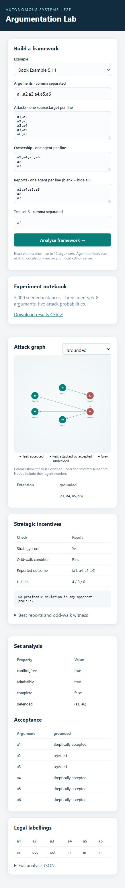
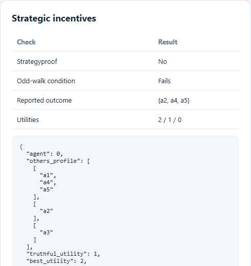
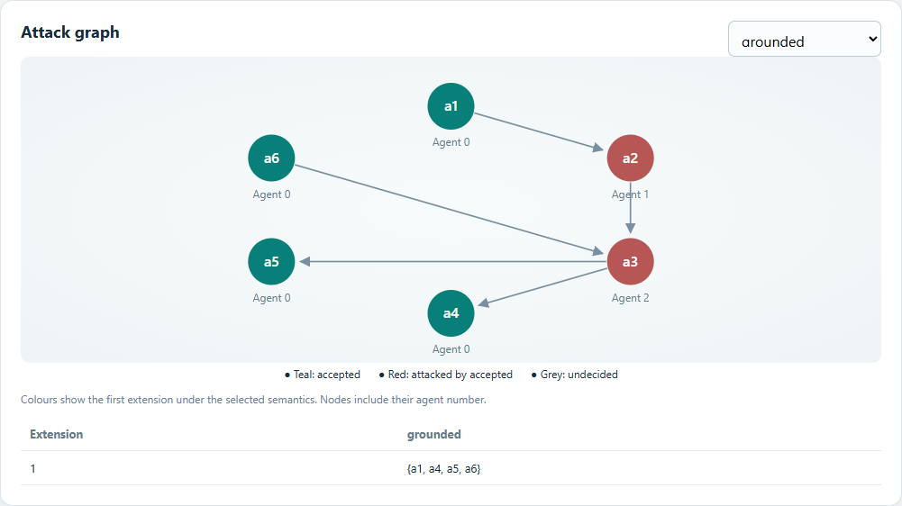
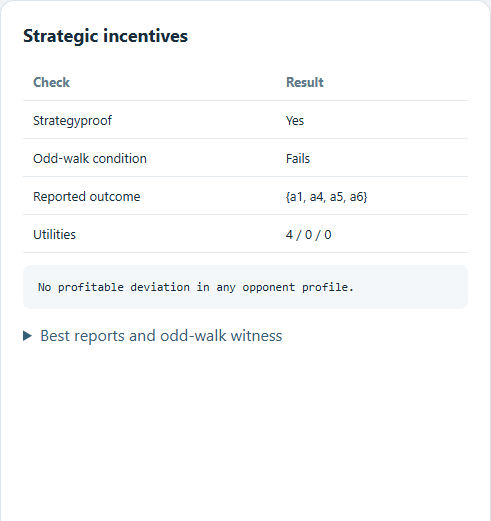

# Demonstration Guide and Presenter Script

**Project:** Argumentation Engine and Strategic Revelation

**Course:** Autonomous Systems (CSL7650), Assignment 3

This demonstration shows the semantic engine, strategic-revelation mechanism, reproducible experiments, and verification evidence. The results below are exact expected outputs, so the guide can also be used as an assessment checklist.

## Before the demonstration

From the repository folder, verify the project once:

```powershell
python --version
python -m unittest -v
python demo.py
```

Python 3.10 or newer is required. The tests should finish with `Ran 8 tests` and `OK`. No package installation or internet connection is required.

Start the local interface:

```powershell
python server.py
```

Open **http://127.0.0.1:8000**. If that port is occupied, run `python server.py --port 8001` and open http://127.0.0.1:8001. Windows users may alternatively double-click `START_UI.cmd`.

Before presenting:

- Keep the browser, `results/summary.csv`, and a terminal open.
- Set browser zoom so the graph and result panels are visible together.
- Leave the server terminal running throughout the demonstration.
- Use the saved `results/demo.txt` and `results/verification.txt` as backup evidence if live execution is unavailable.

## 1. Introduce the system — 30 seconds

**Action:** Show the browser interface.

**Say:**

> This project is a self-contained engine for finite abstract argumentation and strategic revelation. Nodes represent arguments and arrows represent directed attacks. The interface lets us edit the framework, agent ownership, revealed reports, and a test set S. The Python engine computes all results exactly; the browser only displays them.

Point out the five supported semantics: **grounded, complete, preferred, stable, and semi-stable**. Mention that agent numbering begins at 0 and interactive analysis is limited to 10 arguments because extension and strategy calculations use exhaustive enumeration.



*Figure 1. Complete interface overview. The input controls appear first, followed by the graph and computed semantic and strategic evidence.*

## 2. Demonstrate defence and extension semantics — 75 seconds

### Defence chain

**Action:** Choose **Defence chain**. Confirm the attacks are `a,b` and `b,c`, meaning a attacks b and b attacks c. Enter `a` in **Test set S**, then click **Analyse framework**.

**Expected result:**

- S is conflict-free: `true`.
- S is admissible: `true`.
- S is complete: `false`.
- The defended set is `{a,c}`.
- The grounded extension is `{a,c}`.

**Say:**

> The set {a} defends itself and c because a attacks c's attacker, b. It is admissible but incomplete because it omits c, which it defends. Grounded semantics iterates the characteristic function from the empty set and reaches {a,c}.

**Action:** Change S to `a,c` and analyse again.

**Expected result:** S is conflict-free, admissible, and complete.

### Mutual attack

**Action:** Choose **Mutual attack** and select **complete** semantics.

**Expected result:** Complete extensions are `{}`, `{a}`, and `{b}`. The legal labellings are:

| a | b |
|---|---|
| undec | undec |
| in | out |
| out | in |

**Action:** Select **preferred** semantics.

**Expected result:** Preferred extensions are `{a}` and `{b}`; each argument is credulously accepted. Stable and semi-stable semantics give the same two extensions for this graph.

**Say:**

> Preferred and semi-stable maximality are evaluated by set inclusion, not merely by largest cardinality. The interface lists every extension and every legal complete labelling.

### Optional edge case if time permits

Choose **Odd cycle**, select **stable**, and analyse. There are no stable extensions, so stable acceptance is explicitly reported as undefined. Under grounded semantics the extension is empty and every node is undecided, although each argument is rejected by the extension-membership acceptance test.

## 3. Demonstrate profitable hiding — Example 5.10 — 90 seconds

**Action:** Choose **Profitable hiding**. The example resets reports to full ownership.

The ownership partition is:

| Agent | Owned arguments |
|---|---|
| x (agent 0) | `a1,a4,a5` |
| y (agent 1) | `a2` |
| z (agent 2) | `a3` |

Here `a1` denotes alpha-1 in the textbook, and similarly for the other names.

**Expected truthful result:**

- Reported grounded outcome: `{a1,a3}`.
- Utilities for x, y, z: `1 / 0 / 1`.
- Exact strategyproofness: **No**.
- Odd-walk condition: **Fails**.
- The deviation witness identifies agent 0, truthful utility 1, best utility 2, and best report `{a4,a5}`.

**Say:**

> Utility counts only an agent's own accepted arguments. The displayed utilities follow the actual ownership partition, correcting the swapped utilities in the printed example. The exact strategyproofness result is stronger than a check at this one profile: it considers every possible report by the other agents.

**Action:** In **Reports**, remove `a1` from the first line so the three lines are:

```text
a4,a5
a2
a3
```

Click **Analyse framework**.

**Expected manipulated result:**

- Reported outcome changes to `{a2,a4,a5}`.
- Utilities change to `2 / 1 / 0`.
- Agent x's utility increases strictly from 1 to 2.

Expand **Best reports and odd-walk witness** to show that `{a4,a5}` is x's optimal report against these opponents' reports.



*Figure 2. Example 5.10 after the profitable deviation: the reported outcome is `{a2,a4,a5}`, and agent x's utility is 2.*

**Say:**

> Hiding a1 removes it and its incident attack. This changes the grounded outcome and raises x's count utility, giving a concrete profitable deviation and proving that this mechanism instance is not strategyproof.

## 4. Separate sufficiency from necessity — Example 5.11 — 60 seconds

**Action:** Choose **Protective defender**. This selection restores truthful reports.

**Expected result:**

- Agent x additionally owns `a6`, which attacks `a3`.
- Truthful grounded outcome: `{a1,a4,a5,a6}`.
- Utilities: `4 / 0 / 0`.
- Exact strategyproofness: **Yes**.
- Odd-walk condition: **Fails**, with witness `a1 → a2 → a3 → a4`.
- The strategic panel states: `No profitable deviation in any opponent profile.`

| Protective-defender graph | Exact strategic result |
|---|---|
|  |  |

*Figures 3–4. Example 5.11. Argument a6 defeats a3; all four arguments owned by agent x are accepted. Exact enumeration finds no profitable deviation even though the odd-walk condition fails.*

**Say:**

> This example shows why the graph condition is sufficient rather than necessary. The same-owner odd walk remains, but a6 defeats a3 and protects x's downstream arguments. Exhaustive search finds no profitable deviation for any agent against any opponents' report profile. The book's later reference to a5 as the added defender is treated as a misprint; the graph shows that the defender is a6.

## 5. Present the reproducible experiment — 60 seconds

**Action:** Open `results/summary.csv`, or click **Download results CSV** in the interface.

Explain the fixed sampling protocol:

- Seed: `20261101`.
- Three nonempty agents.
- Between 6 and 8 arguments per framework.
- 1,000 instances at each attack probability.
- Probabilities: `0.1`, `0.3`, `0.5`, `0.7`, and `0.9`.
- Self-attacks excluded in the baseline run; reciprocal attacks and cycles allowed.

**Expected aggregate results:**

| Attack probability | Instances | Strategyproof fraction | SP and condition | Condition only | SP only | Neither |
|---|---:|---:|---:|---:|---:|---:|
| 0.1 | 1,000 | 0.811 | 297 | 0 | 514 | 189 |
| 0.3 | 1,000 | 0.181 | 14 | 0 | 167 | 819 |
| 0.5 | 1,000 | 0.021 | 0 | 0 | 21 | 979 |
| 0.7 | 1,000 | 0.007 | 0 | 0 | 7 | 993 |
| 0.9 | 1,000 | 0.000 | 0 | 0 | 0 | 1,000 |

**Say:**

> Across all 5,000 instances, no framework passes the sufficient condition while failing the exact strategyproofness test. This is finite evidence consistent with the theorem, not a proof. There are 709 strategyproof frameworks that fail the condition, confirming that it is not necessary. The decrease in strategyproofness across this density grid is an observed experimental trend, not a general monotonicity theorem.

Point out that `results/instances.jsonl` preserves every generated graph, partition, classification, odd-walk witness, and profitable-deviation witness. `results/case_studies.json` and `results/CASE_STUDIES.md` retain representative actual instances and their explanations.

## 6. Show verification and reproducibility — 60 seconds

**Action:** In the terminal, run:

```powershell
python -m unittest -v
python demo.py
```

**Expected result:** Eight tests pass. The executable demonstration prints the mutual-attack semantics and both textbook cases.

**Say:**

> The tests cover textbook outcomes, defence, cycles, self-attacks, validation, the empty framework, parity traversal, and the server analysis path. The strongest independent check enumerates all 27 total labellings for each of the 512 directed three-node graphs, including loops, and compares the locally legal labellings with those generated from complete extensions.

Mention that all 5,000 stored records agree with the summary and all 3,980 stored profitable-deviation witnesses were replayed successfully, as recorded in `results/verification.txt`.

If asked to reproduce the dataset, use:

```powershell
python experiments.py --count 1000 --probabilities 0.1 0.3 0.5 0.7 0.9 --seed 20261101
```

Warn that this command overwrites the baseline `instances.jsonl`, `summary.csv`, and `metadata.json`. Runtime varies by machine. Use **Export JSON** in the UI to retain the complete analysis of a custom framework.

## Closing statement — 15 seconds

> The submission connects formal semantics, strategic incentives, and reproducible evidence in one exact implementation. It computes five extension semantics and legal labellings, produces concrete manipulation witnesses, distinguishes exact strategyproofness from a sufficient structural condition, and retains a complete audit trail for every experimental result.

## Expected-results checklist

- [ ] Local UI launches and displays the attack graph.
- [ ] Defence chain gives grounded extension `{a,c}`.
- [ ] Mutual attack gives three complete extensions and three legal labellings.
- [ ] Example 5.10 changes x's utility from 1 to 2 when x hides `a1`.
- [ ] Example 5.11 is strategyproof even though the odd-walk condition fails.
- [ ] Summary contains 5,000 instances and 709 `strategyproof_only` cases.
- [ ] All eight automated tests pass.
- [ ] The executable demonstration matches `results/demo.txt`.
- [ ] All four UI screenshots render in this guide.

## Common questions

**Why does rejection not always mean `out`?**

Rejection means membership in no extension under the selected semantics. On an odd cycle under grounded semantics, arguments are rejected from the empty grounded extension but labelled `undec`.

**Why is stable acceptance undefined for some graphs?**

A directed odd cycle has no stable extension. Reporting skeptical acceptance over an empty extension family would be misleading, so the engine explicitly returns undefined.

**Does failing the odd-walk condition prove manipulability?**

No. It is a sufficient certificate. Example 5.11 and 709 sampled instances are strategyproof even though the condition fails.

**Why use exhaustive enumeration?**

The assigned frameworks contain only 6–8 arguments. Exact enumeration gives auditable classifications and concrete witnesses without relying on heuristics or random deviation search.

**What are the main limitations?**

The model assumes disjoint ownership, hiding-only reports, count utility, and small finite frameworks. The condition uses positive odd directed walks with repeated vertices allowed. Results apply to the stated sampling distribution and do not establish a general density theorem.
